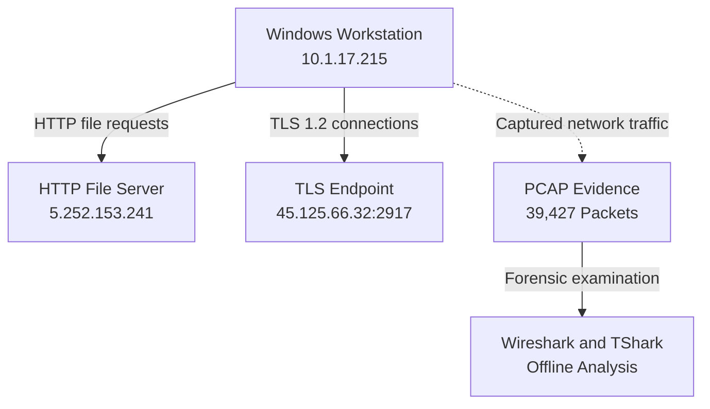

# Network Traffic Investigation Architecture

**Note:** This diagram illustrates observed communications from a training PCAP. The suspected malicious activity has not been independently confirmed through endpoint forensics.

