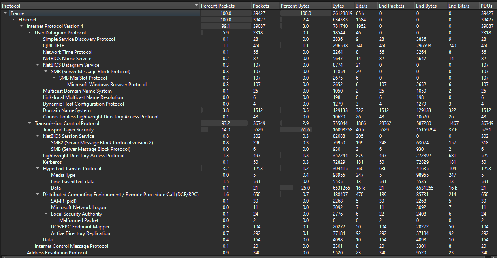
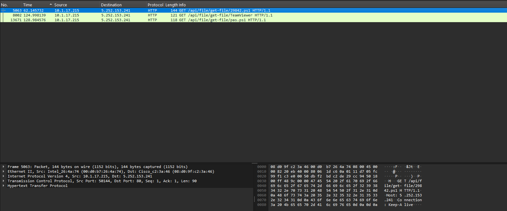
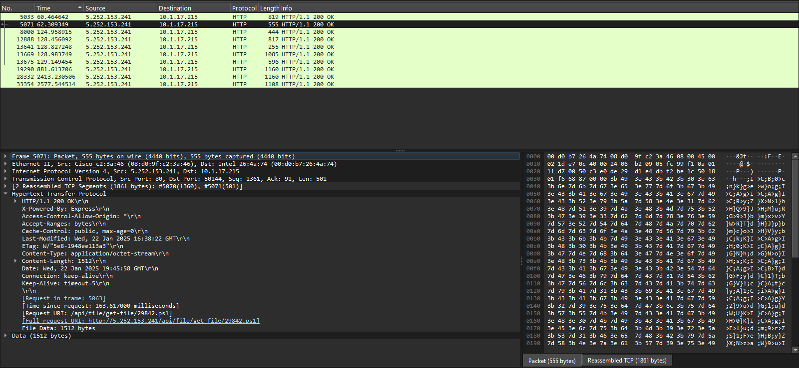
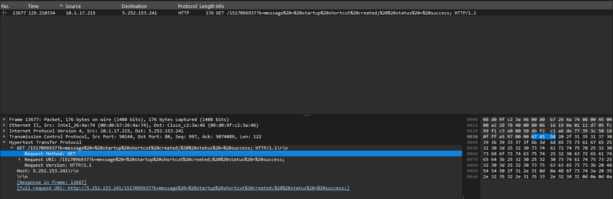
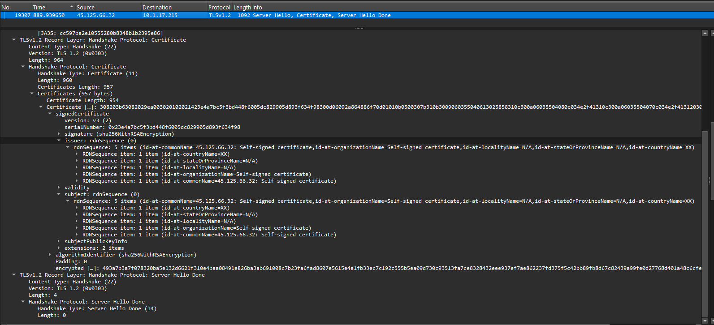

# Network Traffic Investigation & Threat Analysis

### Cybersecurity Portfolio | Project #2

**Network Forensics | Incident Investigation | Threat Analysis | Wireshark | TShark**

## Project Overview

This project demonstrates a practical network forensic investigation using a real-world-style malware traffic analysis exercise.

I analyzed a packet capture (PCAP) using Wireshark and TShark to identify suspicious network connections, investigate potentially malicious file downloads, reconstruct an incident timeline, and document indicators of compromise (IOCs).

The investigation was conducted in an isolated Ubuntu Server virtual laboratory using an offline PCAP dataset.

## Investigation Summary

| Category | Finding |
|---|---|
| Evidence | January 22, 2025 traffic analysis exercise |
| Total packets | 39,427 |
| Capture duration | Approximately 5 minutes 22 seconds |
| Investigated workstation | 10.1.17.215 |
| Suspicious HTTP endpoint | 5.252.153.241 |
| Suspicious TLS endpoint | 45.125.66.32 |
| TLS destination port | 2917 |
| Tools | Wireshark, TShark, Ubuntu Server, VirtualBox |

## Investigation Architecture

The architecture illustrates the observed network communications and the offline forensic analysis process.

See [Investigation Architecture](Documentation/architecture.md).

## Investigation Methodology

**1. Evidence Collection and Validation**

Imported the PCAP into the isolated analysis environment, examined capture metadata, and recorded its SHA-256 hash.

**2. Protocol Analysis**

Examined the protocol hierarchy, including DNS, HTTP, TLS, TCP, UDP, SMB, LDAP, and Kerberos.

**3. Endpoint Investigation**

Identified the main internal workstation and investigated unusual external connections.

**4. HTTP Traffic Investigation**

Identified HTTP requests for PowerShell scripts and TeamViewer-related resources.

**5. TLS Analysis**

Investigated encrypted connections over TCP port 2917 and inspected a self-signed certificate.

**6. Incident Timeline Reconstruction**

Correlated packet numbers, timestamps, HTTP requests, server responses, and suspicious network messages.

**7. Reporting**

Documented the investigation findings, potential indicators of compromise, limitations, and security recommendations.

## Key Findings

### Finding 1 — Suspicious HTTP File Requests

The workstation `10.1.17.215` communicated with `5.252.153.241`.

Observed requests included:

- `/api/file/get-file/29842.ps1`
- `/api/file/get-file/pas.ps1`
- `/api/file/get-file/TeamViewer`
- `/api/file/get-file/Teamviewer_Resource_fr`

The corresponding HTTP responses included successful status codes, suggesting that the requested resources were delivered.

### Finding 2 — Possible Persistence Activity

A captured HTTP request included a status message reporting:

`startup shortcut created; status = success`

This may indicate persistence-related activity. However, network evidence alone does not prove that the shortcut was created on the workstation.

### Finding 3 — Suspicious TLS Communications

The workstation established repeated TLS connections to:

`45.125.66.32:2917`

Certificate analysis identified a self-signed certificate associated with this endpoint.

These connections warrant further investigation, although a self-signed certificate alone does not establish malicious activity.

## Evidence Screenshots

### 1. Protocol Hierarchy

### 2. Suspicious HTTP Requests

### 3. Successful HTTP Response

### 4. Persistence Indicator

### 5. TLS Certificate Investigation

## Potential Indicators of Compromise

| Indicator | Description |
|---|---|
| 10.1.17.215 | Investigated internal workstation |
| 5.252.153.241 | Suspicious HTTP endpoint |
| 45.125.66.32 | Suspicious TLS endpoint |
| TCP 2917 | Unusual TLS service port |
| 29842.ps1 | PowerShell script filename |
| pas.ps1 | PowerShell script filename |

These indicators are specific to the exercise and should be validated before use in production security controls.

## Project Documentation
- [Download the Full Investigation Report (PDF)](Reports/Network-Forensics-Investigation-Report.pdf)
- [Full Investigation Report](Documentation/investigation-report.md)
- [Investigation Architecture](Documentation/architecture.md)
- [Evidence Hash](Documentation/evidence-hash.txt)
- [DNS Analysis](Reports/dns-queries.txt)
- [HTTP Analysis](Reports/http-requests.txt)
- [Suspicious Activity Timeline](Reports/suspicious-timeline.txt)
- [TLS Connection Analysis](Reports/tls-connections.txt)
- [TLS Certificate Details](Reports/tls-certificate-details.txt)

## Skills Demonstrated

- Network traffic analysis
- Digital forensics
- Packet capture investigation
- HTTP and DNS analysis
- TLS certificate inspection
- Indicators of compromise identification
- Incident timeline reconstruction
- Evidence documentation
- Technical security reporting
- Linux command-line investigation

## Investigation Limitations

The investigation was based on an offline network capture. Endpoint execution, persistence, and attacker control were not independently confirmed.

No suspicious files were executed during the investigation.

## Conclusion

This project strengthened my practical understanding of network forensics and incident investigation.

Using Wireshark and TShark, I identified suspicious file requests, analyzed encrypted network communications, reconstructed a network activity timeline, and documented findings using an evidence-based approach.

**Dataset credit:** Malware-Traffic-Analysis.net — January 22, 2025 traffic analysis exercise.